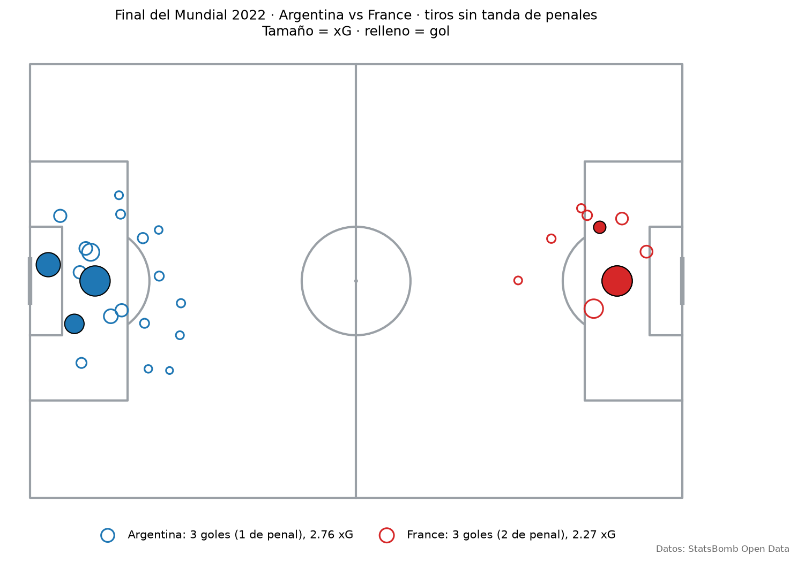

# Mapa de datos del fútbol: qué existe, qué trae y qué permite

*Fase 0 de mi ruta de especialización en análisis de datos de fútbol.*

El fútbol tiene pocos goles y mucho azar. En un partido hay unos 25 tiros y menos de 3 goles, así que el marcador es una señal muy ruidosa de lo que pasó en la cancha. Por eso el análisis moderno mide el **proceso** —la calidad de las ocasiones, la amenaza generada, el control del espacio— y no solo el resultado.

Un ejemplo: la final del Mundial 2022 terminó 3–3, pero Argentina generó 2,76 goles esperados (xG) frente a 2,27 de Francia, sin contar la tanda de penales.

*Tamaño del círculo = xG del tiro; relleno = gol. Datos: StatsBomb Open Data.*

Para medir el proceso hacen falta datos. Este es el mapa de lo que existe.

## Siete familias de datos

Van de la más gruesa (el marcador) a la más fina (la posición de los 22 jugadores 25 veces por segundo). Cada nivel habilita un tipo de análisis distinto.

| Tipo de dato | Qué trae | Qué permite |
| --- | --- | --- |
| Resultados y agregados | Marcador, tiros, posesión y tarjetas por partido | Ratings de equipos, modelos de Poisson, simulación de la tabla |
| Eventos | Cada acción con balón: tipo, (x, y), minuto, jugador y resultado; entre 1.500 y 3.500 por partido | Goles esperados (xG), valor de cada pase o conducción, perfiles de jugadores, redes de pases |
| Eventos con *freeze frame* | Lo anterior más la posición de los jugadores visibles en cada acción | xG que considera a los defensores, opciones de pase, presión |
| *Tracking* | Posición de los 22 jugadores y el balón, de 10 a 25 veces por segundo | Control del espacio (*pitch control*), carreras sin balón, forma del equipo, métricas físicas |
| Físicos y biométricos | GPS, aceleraciones, frecuencia cardíaca, esfuerzo percibido | Control de carga y prevención de lesiones |
| Mercado y contexto | Valor de mercado, contratos, edad, cuotas de apuestas | Valoración de jugadores, curvas de edad, referencia para pronósticos |
| Video | Transmisión o cámara táctica | Generar eventos y *tracking* con visión por computador |

## Datos abiertos para aprender

No hace falta pagar para empezar. Estas fuentes son públicas, aunque cada una tiene sus términos de uso:

| Fuente | Qué trae | Términos |
| --- | --- | --- |
| [StatsBomb Open Data](https://github.com/statsbomb/open-data) | Eventos de 80 combinaciones de competición y temporada, entre ellas la Premier League, La Liga y la Serie A 2015/16 completas; 12 con *freeze frames* 360 | Términos propios, con atribución |
| [Wyscout público](https://doi.org/10.1038/s41597-019-0247-7) (Pappalardo et al., 2019) | Eventos de 7 competiciones de la temporada 2017/18 | CC BY 4.0 |
| [DFL/IDSSE](https://doi.org/10.1038/s41597-025-04505-y) (Bassek et al., 2025) | *Tracking* óptico y eventos oficiales sincronizados de la Bundesliga | CC BY |
| [football-data.co.uk](https://www.football-data.co.uk/data.php) | Décadas de resultados y cuotas de ligas europeas | Términos del sitio |

En Chile todavía no hay datos de eventos abiertos de la Primera División. Por eso aprendo con los datos de mejor calidad disponibles, sean de donde sean, y en la ruta también aprenderé a producir datos propios.

## Cómo los usan los clubes

- **Reclutamiento:** filtrar jugadores por perfil y separar rendimiento de suerte antes de pasar al video.
- **Análisis de rival:** cómo construye, dónde presiona y cómo ejecuta el balón parado.
- **Cuerpo técnico:** si la presión funciona y si el equipo genera ocasiones de calidad.
- **Ciencias del deporte:** quién está sobrecargado y cuándo dosificar.
- **Dirección deportiva:** cuánto vale un jugador y si conviene renovarlo.

En casi todos los casos, el dato filtra y prioriza, y la decisión la toman el video y el cuerpo técnico.

## Lo que me llevo de la primera lectura

Rein y Memmert (2016) muestran que contar acciones descarta el contexto y explica poco. Muestran también que los datos de posición permiten estudiar la táctica como la interacción entre jugadores, pero que la investigación aún no llega a los clubes. Las causas son varias: falta un modelo que integre los análisis, falta colaboración entre disciplinas y los datos no se comparten.

## Qué sigue

En la fase 1 trabajaré con datos de eventos: estandarizarlos, calcular métricas por 90 minutos y medir cuáles son señal y cuáles ruido.

El código, el notebook y la figura están en el repositorio: [analisis-datos-futbol](https://github.com/pablozuniga-fc/analisis-datos-futbol).

## Referencias

- Rein, R. y Memmert, D. (2016). Big data and tactical analysis in elite soccer: future challenges and opportunities for sports science. *SpringerPlus*, 5, 1410. https://doi.org/10.1186/s40064-016-3108-2
- Pappalardo, L. et al. (2019). A public data set of spatio-temporal match events in soccer competitions. *Scientific Data*, 6, 236. https://doi.org/10.1038/s41597-019-0247-7
- Bassek, M. et al. (2025). An integrated dataset of spatiotemporal and event data in elite soccer. *Scientific Data*, 12. https://doi.org/10.1038/s41597-025-04505-y
- StatsBomb Open Data. https://github.com/statsbomb/open-data

---

## Versión corta para LinkedIn

> Empecé una ruta pública de especialización en análisis de datos de fútbol, desde lo básico hasta lo que hoy usan los clubes de élite.
>
> Primera idea: el marcador engaña. La final del Mundial 2022 terminó 3–3, pero Argentina generó 2,76 goles esperados (xG) frente a 2,27 de Francia. Con unos 25 tiros y menos de 3 goles por partido, el azar pesa mucho; por eso el análisis moderno mide el proceso y no solo el resultado.
>
> Para eso existen siete familias de datos: resultados, eventos, eventos con posición de jugadores, tracking, datos físicos, datos de mercado y video. Cada una habilita un nivel de análisis distinto, y varias tienen versiones abiertas para aprender: StatsBomb Open Data, Wyscout público, DFL/IDSSE.
>
> Armé un mapa con qué trae cada tipo de dato, qué permite y dónde conseguirlo. El código y la figura están en mi repositorio: https://github.com/pablozuniga-fc/analisis-datos-futbol
>
> Próximo paso: datos de eventos y métricas por 90 minutos.
>
> #AnálisisDeDatos #Fútbol #Estadística
